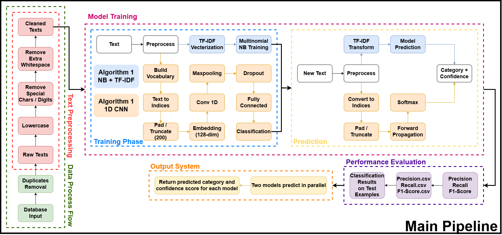

# NLP Document Classification: Naive Bayes + TF-IDF vs 1D CNN

A small command-line document classification system that trains two classifiers on the same text corpus and compares them:

1. **Naive Bayes + TF-IDF** (scikit-learn, 1-2 grams, 5000 features)
2. **1D CNN** (PyTorch; embedding 128-d, Conv1D, max-pooling, dropout, two fully connected layers; sequences padded or truncated to 200 tokens)

It was written for a university NLP module (DTS305TC, coursework 2).



## What the script does

`dcs.py` runs the full pipeline:

- reads `.txt` documents from `Dataset/Dataset/<category>/*.txt` (one sub-folder per class)
- removes duplicate documents
- cleans text (lowercase, strip digits/special characters, normalise whitespace)
- stratified 80/20 train/validation split
- trains both models
- reports precision / recall / F1 on the validation set and writes them to CSV
- classifies a few built-in example texts, then lets you type your own text and returns each model's predicted category with a confidence score

## Results

Validation split of the course corpus (two classes: sport, tech):

| Model | Precision | Recall | F1 |
|---|---|---|---|
| Naive Bayes + TF-IDF | 1.000 | 1.000 | 1.000 |
| 1D CNN | 0.944 | 0.938 | 0.937 |

On the small hand-written test examples in the script the scores are lower (Naive Bayes F1 0.79, 1D CNN F1 0.67). That set is tiny, so treat it as a sanity check rather than a benchmark. Raw numbers are in `results/`.

## Run it

```bash
pip install numpy pandas scikit-learn torch
mkdir -p Dataset/Dataset/sport Dataset/Dataset/tech   # put your .txt files here
python dcs.py
```

The course dataset is not included. Use any corpus laid out as one folder per class. If the folder is missing, the script falls back to a tiny generated sample dataset so it still runs.
